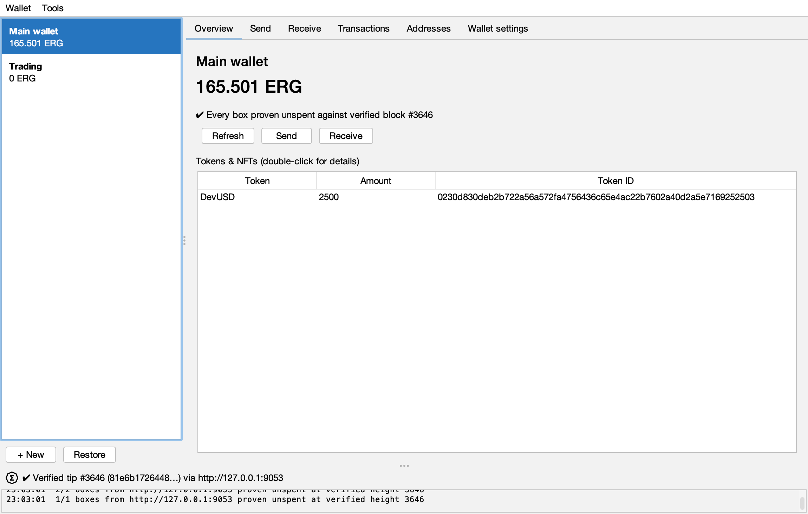
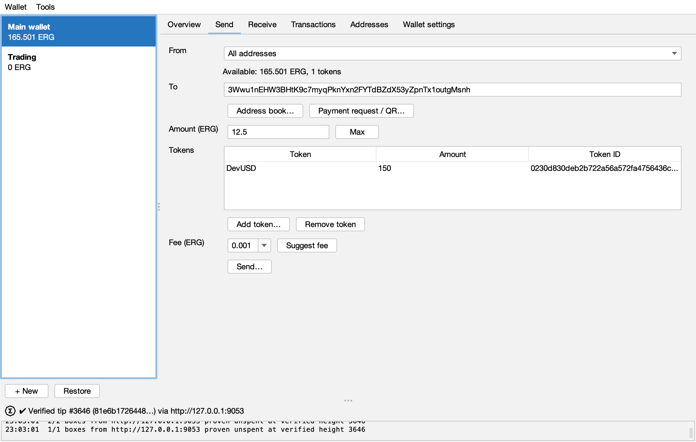
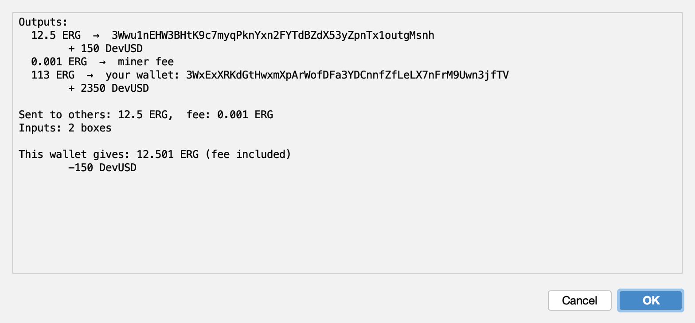
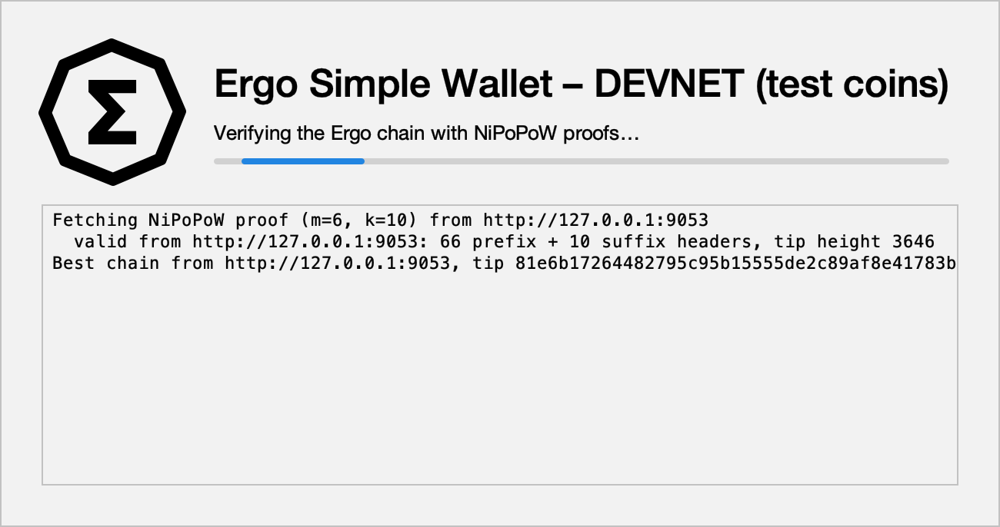
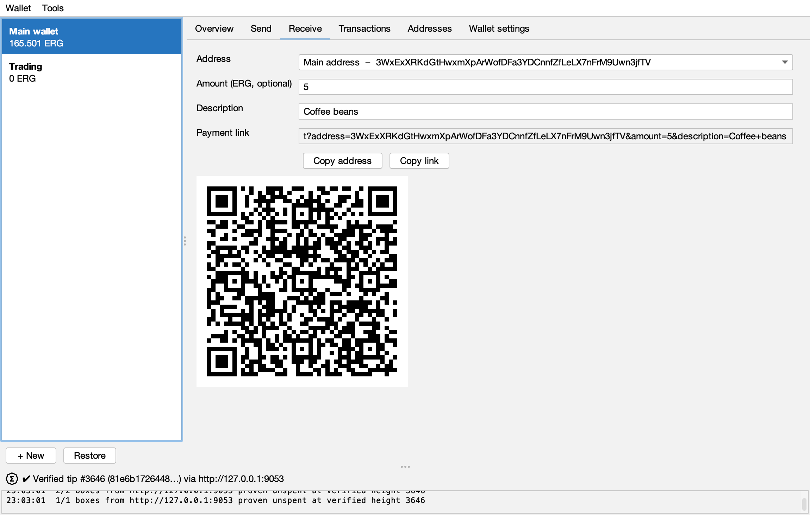
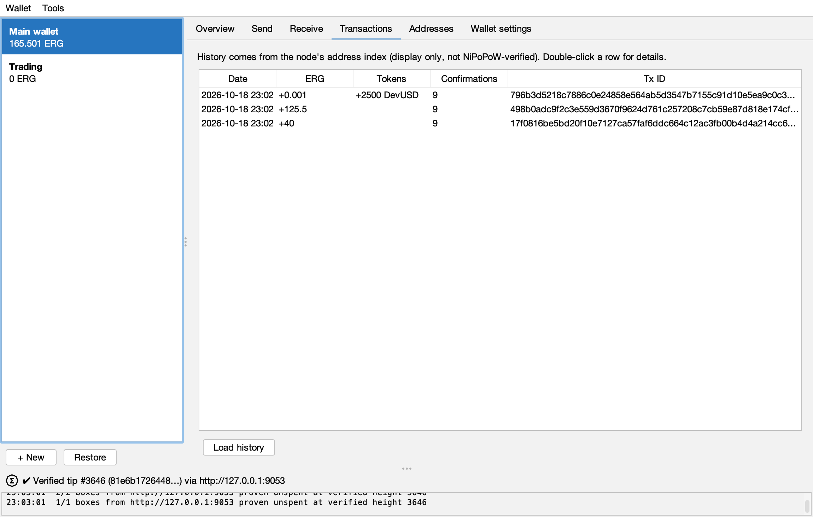
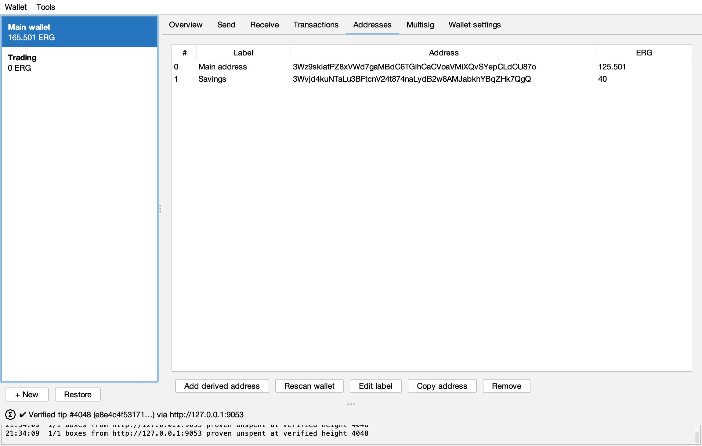
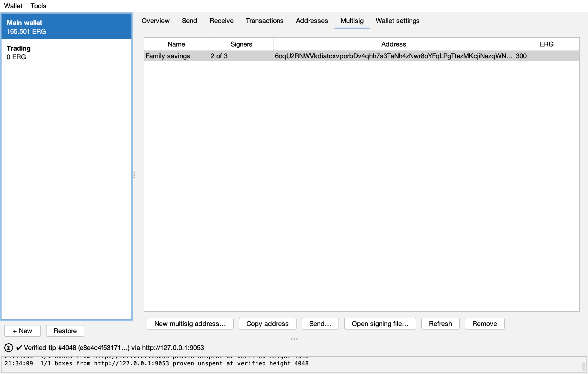
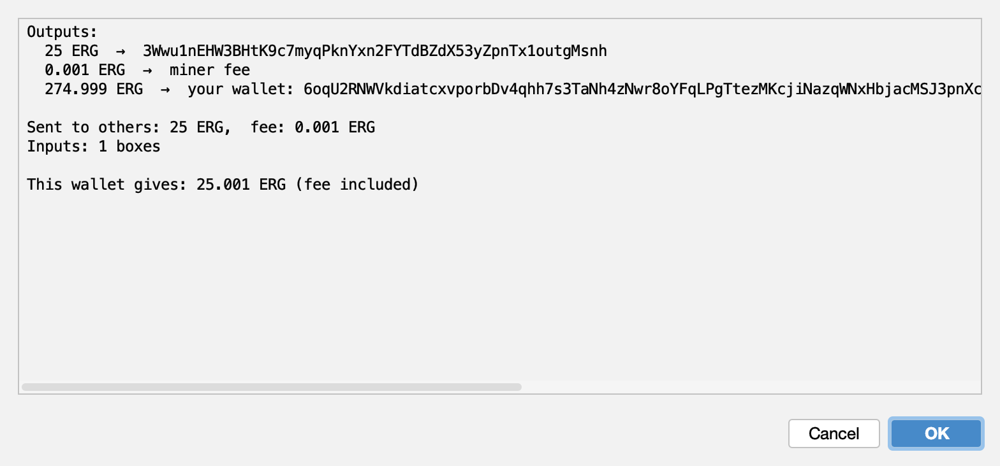

# Ergo Simple Wallet

A light-client Ergo wallet written in **Scala 2.12** + Swing, built with **sbt**, using the FlatLaf IntelliJ (light) theme.
The wallet does not download the blockchain. It verifies the chain with NiPoPoW proofs fetched from several nodes,
then proves that every box of the wallet is unspent with an AVL proof checked against the `stateRoot` of a verified block.

> [!WARNING]
> **Disclaimer: experimental software, use at your own risk.**
> - This wallet has **not been audited**. It is tested end to end on a local devnet and has sent only very few real
>   mainnet transactions. Bugs can lose funds. Try a small amount first, and never keep more in it than you can
>   afford to lose.
> - **Multisig is the newest and least tested feature** (a single mainnet spend so far). Test a multisig address with a
>   small amount, receive and spend, before you rely on it, and check every signer address with its owner.
> - **Back up your mnemonic** on paper. The encrypted wallet file and its backups are useless without the password.
> - **No custody, no support for recovery.** The wallet has no server and nobody else holds your keys: the authors
>   cannot see, freeze, recover or return funds, and will never ask for your mnemonic, password or wallet file.
>   A lost mnemonic, or more lost multisig keys than k-of-n allows, means lost funds. Anyone offering to
>   "recover" a wallet for you is a scammer.
> - Download it only from this repository, or build it yourself from the source.
> - It is an independent project, **not affiliated with or endorsed by the Ergo Platform or the Ergo Foundation**.
> - Token names, history, prices and fee suggestions come from third parties and are not verified. Always check the
>   recipient, the amounts and the "This wallet gives" line before you sign.
> - Provided "as is", without warranty of any kind, under the MIT License (see `LICENSE`). The authors are not liable
>   for any loss.

## Screenshots

Taken from the real app on the [local devnet](#local-devnet-test-coins) (test coins, `3W…` addresses);
regenerate them with `devnet/screenshots.sh`.

| Overview: proven balance and tokens | Send ERG and tokens |
|---|---|
|  |  |

| Confirmation: what leaves the wallet | Startup: NiPoPoW verification |
|---|---|
|  |  |

| Receive: payment link and QR code | Transaction history |
|---|---|
|  |  |

| Addresses: derived addresses, labels, rescan | Multisig: shared 2-of-3 address, proven balance |
|---|---|
|  |  |

| Multisig spend: confirmation before the signing file |
|---|
|  |

## What is NiPoPoW for?

NiPoPoW lets the wallet **check for itself** what nodes tell it, instead of trusting them blindly, without downloading the whole blockchain.

### The problem: light wallets have to trust nodes

A light wallet keeps no blockchain on disk, so it has to ask a node "how much is on this address?".
A dishonest or hacked node can report a wrong balance, or serve a fake chain it built itself.
Checking everything yourself means running a full node: downloading and verifying about 1.9 million block headers plus all transactions.
That is far too heavy for a wallet.

### How NiPoPoW solves it

- Every block needs proof-of-work: its hash must be below a target. Now and then a miner gets "lucky" and finds a hash
  far below the target (2×, 4×, 1000× smaller…); such blocks are called **superblocks**.
- Superblocks appear with a fixed probability, so their number reflects the total work behind the whole chain.
  Like dice: showing 10 rolls of "six sixes in a row" is enough to prove millions of rolls, without seeing each one.
- Every Ergo block carries pointers (**interlinks**) to earlier superblocks. That lets a node send a compact proof:
  a few hundred superblocks linked from the genesis block to near the tip, plus the latest few blocks.
  In practice: **~140 headers, ~600 KB, a few seconds**, instead of 1.9 million headers.
- The wallet checks every header: it recomputes the ID, verifies the Autolykos proof-of-work, and checks that the pointers link up.
  Faking a proof means mining that many superblocks yourself, i.e. as much work as the whole Ergo network.
- The wallet asks **several nodes** and compares their proofs; the chain with more work wins. One honest node is enough to find the real chain.
  Proofs are scored by **work**: each superblock counts `difficulty × 2^level`, never just "one more header",
  so a long fork of cheap low-difficulty headers loses against the real chain.

### NiPoPoW in this wallet

```
NiPoPoW   →  latest header of the real chain (the "✔ Verified tip #…" line in the status bar)
                  │
                  ▼  the header holds stateRoot = a "fingerprint" of the whole UTXO set
AVL proof →  the node proves each of your boxes is in that UTXO set
                  │
                  ▼
          the balance on screen is a proven balance
```

So a node **cannot** invent funds you do not have, report a spent box as unspent, or move you onto a fake chain.

**What NiPoPoW does not protect against:**
- A node can still **hide some boxes**: the balance then shows lower than the real one, never higher.
- Transaction history, token names, token decimals and prices come from the explorer/CoinGecko and are **not verified**.
  The send confirmation therefore also shows token amounts in raw units, which is what the transaction really moves.
- You need **at least one honest node** in the node list.
- Per-block difficulty is not checked against Ergo's adjustment rules (the reference implementation does not check it either).
  Because proofs are scored by work, faking a chain that beats the real one costs as much proof-of-work as the real one.
  When no honest node answers there is nothing to compare with, so every suffix header must also carry at least
  `LightClient.MinMainnetDifficulty` (2·10¹³, about 30% of the mainnet difficulty in late 2026): faking a tip alone then
  still costs mining 10 blocks at that difficulty.

## Requirements

- Java 17 or later (tested with Temurin 21)
- sbt 1.10+ (the project pins `sbt.version=1.10.7` in `project/build.properties`; an sbt 2.x launcher works too)
- Internet access to Ergo mainnet nodes

Scala 2.12 is required: ergo-appkit is only published for Scala 2.12.

## Run

```bash
sbt run
```

The first run downloads Scala and the dependencies (appkit, FlatLaf, zxing…), which takes a few minutes.
The app runs in its own JVM (`run / fork := true`), not inside sbt.

### Build a standalone jar

```bash
sbt assembly
java -jar target/scala-2.12/ergo-simple-wallet.jar
```

`target/scala-2.12/ergo-simple-wallet.jar` (~44 MB) bundles every dependency (sbt-assembly). It only needs Java 17 or later, not sbt.
On start-up, after the password, a splash screen with the spinning Ergo logo shows the NiPoPoW sync from the configured nodes
(about 10 seconds). The wallet opens only once the chain is verified, then verifies balances. If no node returns a valid proof,
the splash offers **Retry**, **Settings…** and **Open anyway**. In the main window, the small logo in the status bar spins while
background work (sync, balance checks, sending) runs.

## Tests

```bash
sbt test
```

Tests are written with ScalaTest:
- `NipopowSpec` runs offline, using a real mainnet NiPoPoW proof as a fixture.
- `LightClientSpec` runs offline against local fake nodes serving the mainnet proof fixture: parallel sync,
  a broken node skipped, a node answering with other m/k rejected.
- `StoreSpec` runs offline: the encrypted wallet file (permissions, round trip, wrong passwords, tampering, broken files),
  sealed mnemonics, lock/unlock, backup/restore and the password policy.
- `MultisigSpec` runs offline: the k-of-n address, both signing rounds for 2-of-3, 3-of-4, 1-of-2 and 2-of-2 over
  several inputs, and refused commitments, nonces and tampered proofs.
- `ErgoSpec` runs offline, except two tests that need the network: transaction build/sign (appkit needs a node)
  and the explorer half of the token-info cache test.

## Local devnet (test coins)

`devnet/` runs a private Ergo chain on your machine (Ergo node 6.0.8, devnet config, mining on the CPU), so the wallet
can be tried end to end without real ERG. Needs Java 11+ and about 2 GB of RAM for the node.

```bash
devnet/node.sh            # terminal 1: downloads the node jar (checksum verified), mines, keeps running
devnet/check.sh           # end-to-end check: NiPoPoW sync, funding, proven balance, discovery, send ERG and a token, history
devnet/wallet.sh          # opens the wallet on the devnet
devnet/fund.sh <address> 100   # sends 100 test ERG from the node's mining wallet to your wallet address
devnet/mint.sh <address> DevUSD 1000 2   # mints a new token (1000.00 DevUSD) straight to an address
devnet/screenshots.sh     # retakes docs/screenshots/*.png from the real app (throw-away wallet folder)
```

- Mining rewards can be spent after 720 blocks: `check.sh` and `fund.sh` work once the chain is past ~730 blocks
  (about 10–15 minutes after the first start).
- The devnet mode is `-Dergo.network=devnet`: testnet addresses (`3W…`), node `http://127.0.0.1:9053`, wallet data in
  `~/.ergo-simple-wallet-devnet` (never mixed with the mainnet file), "DEVNET" in the window title, no fiat price.
- A devnet's genesis block is random, so the scripts pin the genesis of the running node with `-Dergo.genesis=<id>`;
  proofs from any other chain are rejected, as on mainnet.
- There is no explorer: transaction history and token details (name, decimals, NFT data) come from the node's own index.
- Delete `devnet/data` to start a fresh chain (the devnet wallet file can stay; rescan it after the new chain is funded).

## Getting started

On first launch you create **one shared password** that encrypts the whole data file. It must have
at least 12 characters and be hard to guess (zxcvbn score ≥ 3: common passwords, keyboard patterns, repeats… are refused);
the dialog shows a strength meter. A few random words make a good password.

After that, enter this password at start-up. The app **asks for the password again** before signing transactions (Send, ErgoPay),
ErgoAuth, showing the mnemonic and changing the password (*Wallet → Change password…*).

The app **locks itself after 5 minutes of inactivity** (or *Tools → Lock now*): the decryption key is wiped from memory,
any open dialog is closed, and the window only shows a password field.

1. **Create a wallet**: *Wallet → Create new wallet*. Write down the 15 mnemonic words, then name the wallet.
2. **Restore a wallet**: *Wallet → Restore wallet*. Enter the mnemonic. Tick *Pre-1627 key derivation* only for wallets created with old Yoroi or node versions.
   After restoring, the wallet **rescans** automatically to find used derived addresses (if the chain is not synced yet, the rescan starts right after the sync).

Wallet tabs:

| Tab | What it does |
|---|---|
| Overview | Verified balance, fiat value, tokens/NFTs (double-click for details) |
| Send | Send ERG + tokens, address book, read payment requests/QR codes, fee suggestions |
| Receive | Payment request link + QR code |
| Transactions | Transaction history (from the explorer) |
| Addresses | Derive more addresses, rescan, labels |
| Multisig | k-of-n addresses shared with other wallets: create, verified balance, send (ERG only), co-sign |
| Wallet settings | Rename, show mnemonic/xpub, delete wallet |

*Tools* menu:

- **Open link / scan QR**: paste a link or load a QR image. The wallet recognises payment requests, `ergopay:` and `ergoauth://`.
- **ErgoPay / ErgoAuth**: sign a transaction or authenticate to a dApp with the selected wallet.
- **Rescan wallet**: rescans the derived addresses of the selected wallet (index 0, 1, 2, …), adds every address that was ever used,
  and stops after 20 unused addresses in a row (BIP44 gap limit), then re-verifies balances. Runs automatically after restoring from a mnemonic; can be run again at any time.
  Whether an address is "used" comes from the node's address index (not verifiable); balances are still verified as usual.
- **Lock now**: lock the app immediately.
- **Backup wallets…**: save a copy of the data file (encrypted with the current password) where you choose. It holds all wallets, the address book and settings.
- **Restore from backup…**: pick a backup file, enter its password, review its wallets and confirm. All current data is replaced by the backup;
  the old file is kept as `data.json.before-restore`. After a restore the app uses the backup's password.
- **Sync NiPoPoW now / Refresh balances**: re-sync the chain and balances.

QR codes are read from image files or a screenshot in the clipboard. The wallet does not use a webcam.

### Multisig (k-of-n)

A multisig address is the contract `atLeast(k, Coll(PK(a), PK(b), …))`: any k of the n participants can spend from it.
Every participant creates it in the *Multisig* tab from the **same addresses in the same order** and the same k, and so gets the same address.

**Which address of a wallet to use.** Any address listed in the wallet's *Addresses* tab works: the wallet signs with the
key at that address's index (#0, #1, …). Prefer the **main address (#0)**, which the dialog fills in:

- Restoring from the mnemonic only finds derived addresses that have been used on chain. A derived address used only
  as a multisig signer never received funds, so it is not found again, and the wallet no longer sees itself as a signer.
  Add it back with *Add derived address* up to its index (the key comes from the same mnemonic; nothing is lost).
  If you use a derived address, write its index down next to the mnemonic.
- *Remove* on an address in the *Addresses* tab also stops the wallet from signing for it, until it is added again.
- A wallet holding several of the signer addresses signs for all of them: in a 2-of-3 where one wallet holds two of
  the addresses, that wallet alone can spend.

Ergo's signatures are interactive (two rounds), so a spend goes round the signers as one **signing file** (JSON, no server involved).
For 2 signers on two wallets:

1. **Wallet 1** chooses *Send…*, confirms the transaction and saves the signing file. Its commitment is added at once;
   that needs no password (a commitment is a random nonce for a public key, it signs nothing).
2. **Wallet 2** opens the file (*Open signing file…*), confirms, enters its password: it commits and signs in one go.
3. The file goes **back to wallet 1**, which opens it, enters its password and signs; the transaction is then complete
   and submitted.

So each signer enters its password once. With k > 2 the other signers commit first (step 2 without signing until all
k have committed), then sign in any order; the k-th signature submits. A wallet holding k signer addresses itself
needs no file: *Send…* signs and submits at once.

Before committing or signing, the wallet checks that every input is an AVL-verified box of a multisig address in its
*Multisig* tab and that the file's signing condition is exactly that address's k and participants. So each signer must
have added the address and refreshed its balance; a file that fails the check is refused (a forged file could otherwise
turn a partial signature into a valid signature for one of your plain addresses).

A commitment is used for one signature only: the wallet deletes it as it signs, because signing a second challenge with
it would reveal the private key. If the file gets lost after round 1, start again with a new *Send…*.
For the same reason *Restore from backup…* drops all commitments: a backup may hold one that was used since. Signing
files in progress must then be started again. Never copy an older `data.json` back by hand.
Like Ergo's own multisig, this two-round scheme is weakened if one signer runs many signing sessions at the same time
with untrusted co-signers: keep sessions few and one at a time.

## Settings

Open *Wallet → Settings…* to change:

- **Nodes**: one node per line. The wallet fetches a NiPoPoW proof from every node and picks the best chain among the valid proofs.
  At least one node needs the **extra address index** (`/blockchain/box/unspent/byAddress`) to find the wallet's boxes.
  Defaults: `https://sv1.erg.vn`, `https://sv2.erg.vn` (with address index) and `https://node.ergo.watch` (NiPoPoW only).
- **Explorer API**: defaults to `https://api.ergoplatform.com`. Only used for transaction history and token information.
- **Fiat currency**: currency used to display prices (from CoinGecko).

## Data

Everything is stored in `~/.ergo-simple-wallet/data.json` (permissions `600`), and **the whole file is encrypted**:
wallet names, addresses, xpubs, address book, settings and mnemonics.

- The key is derived from the shared password with **Argon2id** (64 MiB, 3 iterations, random 16-byte salt), then the data is encrypted with AES-256-GCM.
  The Argon2 parameters are stored in the header and authenticated by GCM, so editing the header makes decryption fail.
- Inside the file, each mnemonic is encrypted once more with the same key. While the app runs, a mnemonic is only
  decrypted into a `char[]` when signing, and wiped right after.
- The decryption key stays in memory while the app is unlocked (to save the file and open mnemonics when signing), and is wiped when the app locks.
- Password fields are wiped right after they are read.
- Files from older versions cannot be opened. The app reports an error and exits; move that file away and restore your wallets from their mnemonics.
- **If you forget the shared password, the file cannot be opened.** You then have to restore each wallet from its mnemonic.

The file is written atomically, so it is not corrupted if the app stops abruptly.
**Back up your mnemonics.** Losing both the data file and the mnemonic means losing the funds.

## How much the data can be trusted

| Data | Source | Verified? |
|---|---|---|
| Chain tip | NiPoPoW proofs from several nodes | Yes: Autolykos v1/v2 PoW, interlinks, header IDs; best proof chosen by work. A tip older than 30 minutes is flagged ⚠ (a stuck node can only offer an old one) |
| Balance, wallet boxes | Node + AVL proof | Yes: proven unspent against the verified `stateRoot` |
| List of an address's boxes | Node's address index | A node can hide boxes but cannot invent them |
| History, token names, NFT images | Explorer | No, display only |
| Fiat price | CoinGecko | No |
| Fee suggestions | Node | No. Double-check them; the minimum is 0.001 ERG |

## Source layout

Sources are in `src/main/scala/vn/erg/wallet/` (package `vn.erg.wallet`).

| File | Contents |
|---|---|
| `Nipopow.scala` | NiPoPoW proof verification, Autolykos PoW, interlinks |
| `LightClient.scala` | Multi-node sync, UTXO verification with AVL proofs |
| `Ergo.scala` | Keys/addresses, transaction building, ErgoPay, ErgoAuth, payment requests, explorer |
| `Store.scala` | Encrypted data file (shared password) and mnemonics |
| `Qr.scala` | QR encode/decode (zxing) |
| `Bip39.scala`, `Http.scala` | BIP39 mnemonics over `Array[Char]`, HTTP client |
| `WalletApp.scala`, `Dialogs.scala` | Swing user interface |
| `ErgoLogo.scala` | Spinning Ergo logo (path data from ergo-wallet-app, Apache-2.0) |

## Limitations

- Mainnet only.
- No read-only (watch) wallets and no cold-wallet signing (EIP-19).
- Not implemented yet: unconfirmed (mempool) balance, ErgoPay with multiple addresses, Babel fees, Mosaik, CSV export.
- The wallet has never sent a real transaction. Try a small amount first.
